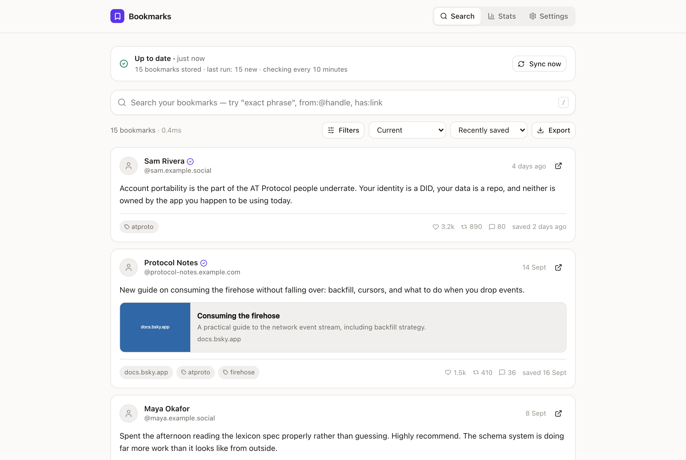
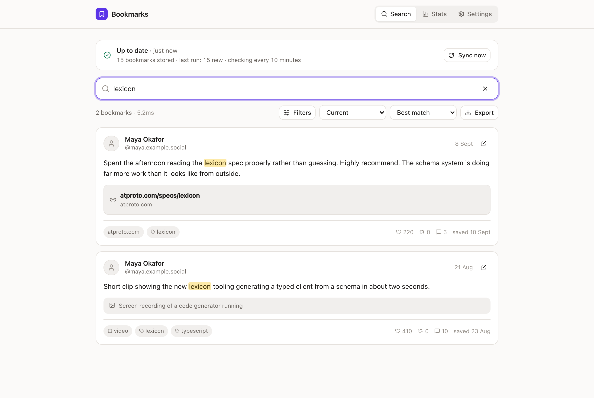
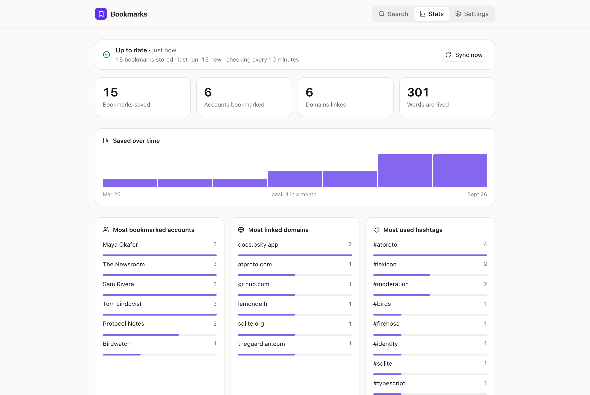
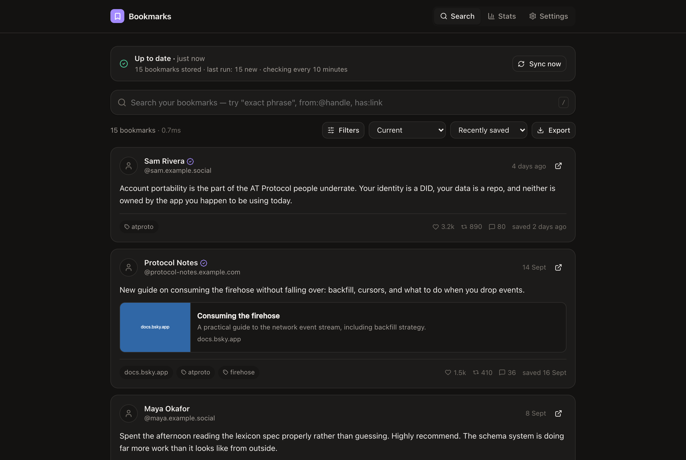
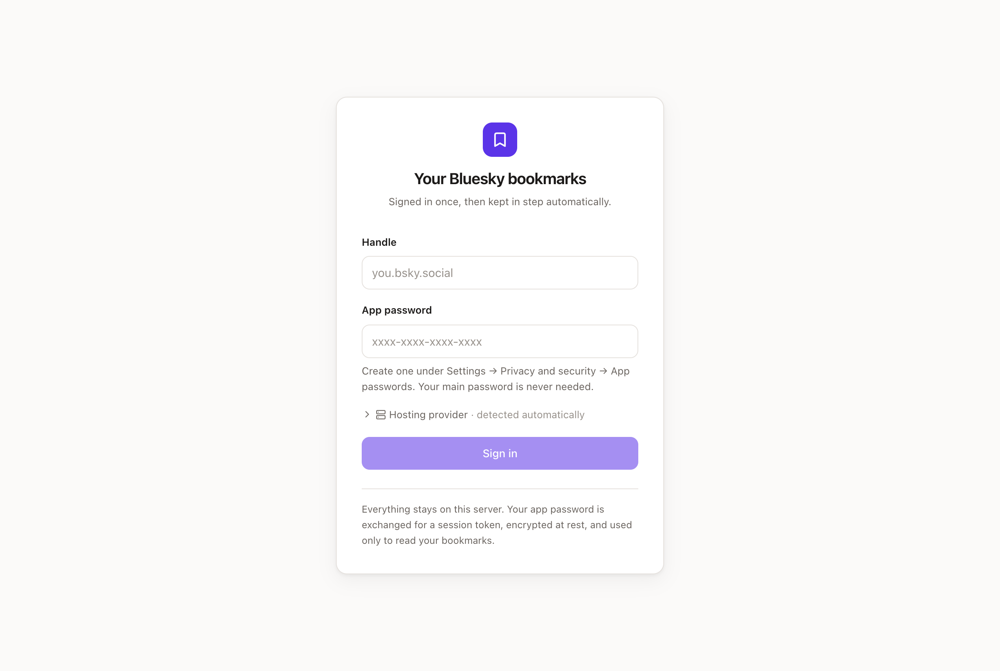
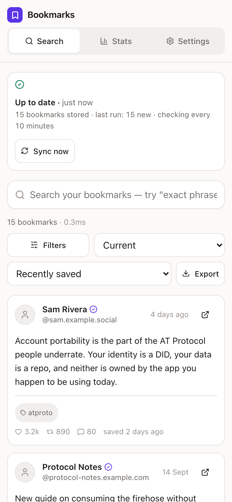
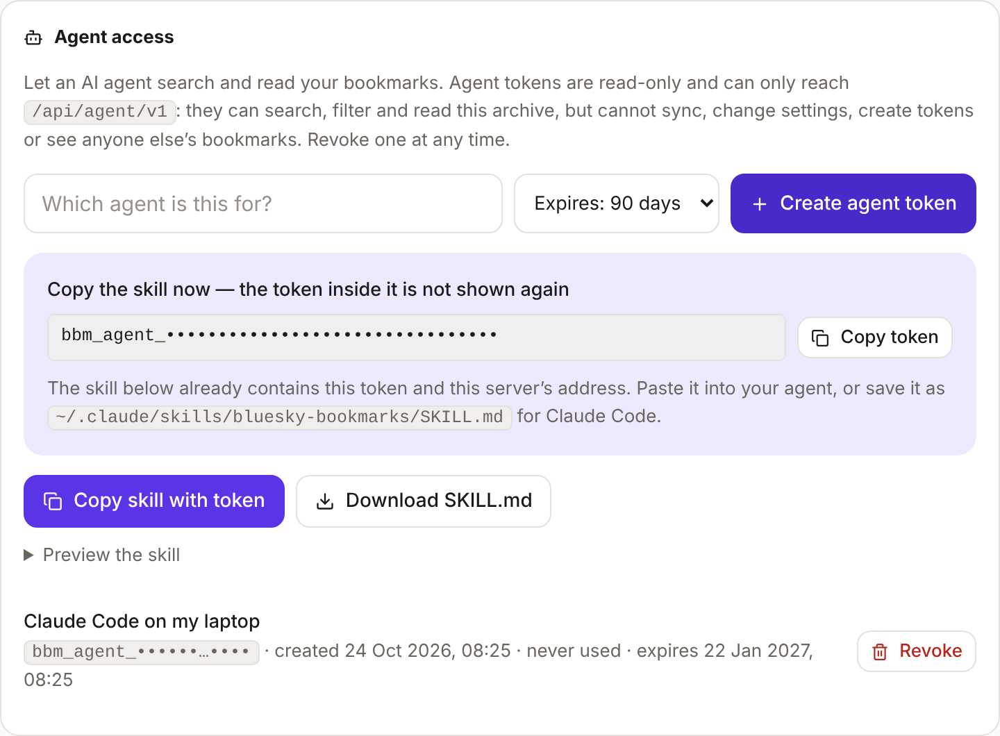

# Bluesky Bookmark Manager

A self-hosted, searchable archive of your Bluesky bookmarks, with an API your AI
agents can use.

Bluesky lets you bookmark posts, but finding one again means scrolling. This
runs on your own machine, copies every bookmark you have into a local database,
keeps it in step with Bluesky every ten minutes, and gives you a fast search
engine over all of it: exact phrases, typo-tolerant matching, and filters for
author, site, hashtag, date, media and more.

> **There is no public instance.** You run it yourself — on a laptop, a home
> server, a Raspberry Pi or a small VPS. Your bookmarks and your sign-in never
> leave that machine, except to talk to Bluesky.



## Contents

- [What it does](#what-it-does)
- [Screenshots](#screenshots)
- [Install](#install) — [Docker](#with-docker-recommended) · [from source](#from-source) · [first sign-in](#signing-in)
- [Searching](#searching) and [exporting](#exporting)
- [Using it with AI agents](#using-it-with-ai-agents)
- [API](#api)
- [Configuration](#configuration)
- [How syncing works](#how-syncing-works)
- [Privacy and security](#privacy-and-security)
- [Development](#development)

## What it does

- **Backfills everything.** The first sync walks your whole bookmark list, with
  live progress in the interface.
- **Stays in step.** A quick check every ten minutes picks up new bookmarks; a
  full reconciliation every hour also notices the ones you have removed.
- **Keeps what Bluesky loses.** Un-bookmarked, deleted and blocked posts stay in
  your archive, flagged rather than dropped.
- **Derives metadata worth searching.** Links and their domains, images and
  their alt text, video, quote posts, replies versus top-level, mentions,
  hashtags, languages, labels, author verification, engagement counts, word
  counts, and when each post was written versus when you saved it.
- **Searches properly.** Exact phrases in quotes, typo-tolerant fuzzy matching
  outside them, BM25 relevance ranking, and filters on every piece of metadata.
- **Works with AI agents.** Create a read-only token, copy a ready-made skill
  file from Settings, and your agent (Claude, ChatGPT, your own scripts) can
  search your bookmarks with filters the interface does not even have.
- **Exports cleanly.** Netscape bookmark HTML (the format browsers, Raindrop and
  Pocket import), plus JSON, CSV and NDJSON.
- **Installs as an app** on your phone or desktop, and has a full HTTP API.

Built on Bluesky's official [`@bsky/sdk`](https://www.npmjs.com/package/@bsky/sdk)
and the `app.bsky.bookmark.*` lexicons. One Node process and one SQLite file;
no external database, queue or cloud service.

```
┌─ web ──────────────┐     ┌─ server ─────────────────────────────┐     ┌─ your PDS ─┐
│ React + Vite       │────▶│ Fastify · SQLite + FTS5              │────▶│ app.bsky   │
│ search · stats     │◀────│ sync engine · search · exports · API │◀────│ .bookmark  │
└────────────────────┘ SSE └──────────────────────────────────────┘     └────────────┘
```

## Screenshots

All screenshots use the made-up demo data from `npm run seed:demo -w server`;
the accounts and posts are not real.

| Search with highlighted matches | Stats |
| --- | --- |
|  |  |
| **Dark mode** | **Sign in** |
|  |  |

<p align="center">
  
  <br><em>On a phone, or installed as an app</em>
</p>

## Install

### What you need

- A machine to run it on that stays on if you want syncing to continue: your
  own computer is fine to try it, a home server or Raspberry Pi is better.
- **Either** [Docker](https://docs.docker.com/get-docker/) with Compose
  (recommended), **or** [Node.js](https://nodejs.org/) 22.12 or newer.
- A Bluesky account and an **app password** for it (Bluesky → **Settings →
  Privacy and security → App passwords**). Your main password is never used.

### With Docker (recommended)

```bash
git clone https://github.com/j4ckxyz/bluesky-bookmark-manager.git
cd bluesky-bookmark-manager
cp .env.example .env    # optional — edit to change the port and other settings
docker compose up -d
```

Open <http://localhost:8787> and [sign in](#signing-in). That's it: the server
starts syncing straight away and keeps going in the background, and it restarts
with the machine.

Everything lives in a Docker volume called `bookmarks-data`, so rebuilding or
updating the container never touches your archive.

#### Changing the port

If port 8787 is already in use on the host (`failed to bind host port
0.0.0.0:8787/tcp: address already in use`), set `HOST_PORT` in `.env`:

```bash
echo 'HOST_PORT=8080' >> .env
docker compose up -d
```

Then open <http://localhost:8080>. The server keeps listening on 8787 *inside*
the container; only the host side moves, and `PUBLIC_URL` follows `HOST_PORT`
automatically unless you set it yourself.

Note `PORT` in `.env` is for running from source (`npm start`) and is ignored
under Docker — use `HOST_PORT` there.

#### Other settings

Anything in `.env.example` can go in `.env`: `MULTI_USER`, `ALLOWED_HANDLES`,
`SYNC_INTERVAL_MINUTES`, `ENCRYPTION_KEY`, `LOG_LEVEL` and the rest. Values you
leave out or leave blank fall back to the server's own defaults. Apply changes
with `docker compose up -d` — no rebuild needed, since these are read at
container start. See [Configuration](#configuration).

#### Updating

```bash
cd ~/bluesky-bookmark-manager
./update.sh
```

That pulls the latest commit, rebuilds the image, restarts the container and
waits until `/api/v1/health` answers, printing the logs instead if it does not
come up. Your database, sign-in and `.env` are all kept: the data lives in the
`bookmarks-data` volume, which is never touched.

The script refuses to run with uncommitted changes rather than risk clobbering
them. Options:

| Flag | Effect |
| --- | --- |
| `--prune` | Also delete dangling images afterwards. Worth using on a Raspberry Pi, where rebuild layers add up. |
| `--no-pull` | Rebuild and restart what is already checked out, without pulling. |

The equivalent by hand is `git pull && docker compose up -d --build`.

Schema changes are applied automatically on start: each migration runs once, in
order, and restarting an already-migrated database does nothing. There is no
separate migration step to remember.

#### Backups

The whole archive is one SQLite file in the `bookmarks-data` volume. Take a
consistent copy while the server is running with:

```bash
docker compose exec bookmarks node server/dist/backup.js
```

That writes `/data/backups/bookmarks-<timestamp>.db` inside the volume and
prints the path; pass a path to write somewhere else. Copy it off the machine
with `docker compose cp bookmarks:/data/backups ./backups`. From source, run
`npm run backup -w server`.

Do not just `cp` the live `bookmarks.db`: the database runs in WAL mode, so
recent writes can still be sitting in `bookmarks.db-wal`. To restore, stop the
container, put the backup in place as `/data/bookmarks.db` and start it again.
If you let the server generate its own key, back up `/data/encryption.key` too,
or you will need to sign in again after restoring.

### From source

Requires Node 22.12 or newer.

```bash
git clone https://github.com/j4ckxyz/bluesky-bookmark-manager.git
cd bluesky-bookmark-manager
npm install
npm run build
npm start
```

Open <http://localhost:8787>. Data is kept in `./data` (change it with
`DATA_DIR`). To keep it running after you close the terminal, use a process
manager such as systemd or `pm2`; to update, `git pull`, then `npm install`,
`npm run build` and restart.

### Signing in

1. In the Bluesky app, go to **Settings → Privacy and security → App passwords**
   and create one. Your main password is never needed and will not work if the
   account has two-factor authentication on.
2. Enter your handle. Suggestions appear as you type, and your hosting provider
   is detected automatically — you can override it if detection is wrong or you
   run your own PDS.
3. Sign in. The backfill starts immediately and reports progress as it goes.

By default the first account to sign in claims the instance. To let other people
use the same server, set `MULTI_USER=true`; each account gets its own private
archive, and the server syncs all of them.

#### Using more than one device

Sign in again on the other device with the same handle and app password. A
claimed single-user instance stays open to the account that claimed it, so
phones, tablets and laptops can all hold their own session at once; sessions are
independent, and signing out on one leaves the others alone. Sessions last
`SESSION_TTL_DAYS` (30 by default).

`MULTI_USER` is only about letting a *different* Bluesky account in. Leave it
off for your own devices.

To reach it from other devices, open `http://<that machine's address>:8787`
on the same network, or put it behind [Tailscale or a reverse
proxy](#it-needs-https) to use it from anywhere.

### Installing as an app

The web interface is a PWA: it installs to a home screen, opens without browser
chrome, and starts offline.

- **iPhone or iPad:** open the site in Safari, then **Share → Add to Home
  Screen**. It launches full-screen, with the layout padded around the notch and
  the home indicator.
- **Android or desktop Chrome:** use the install button in the address bar.

#### It needs HTTPS

Service workers only run in a secure context, so **offline support and the
Chrome install prompt need `https://`** — a plain `http://` LAN or Tailscale
address will not do, though iOS will still add it to the home screen. `localhost`
counts as secure, which is why it works in local development.

The least painful way to get a real certificate on a home server is Tailscale,
which issues one for your tailnet:

```bash
sudo tailscale cert "$(tailscale status --json | jq -r .Self.DNSName | sed 's/\.$//')"
sudo tailscale serve --bg 8787
```

That publishes the app at `https://<machine>.<tailnet>.ts.net`. Point
`PUBLIC_URL` at it and turn on `TRUST_PROXY`, which also switches session
cookies to secure-only:

```bash
PUBLIC_URL=https://raspberrypi.your-tailnet.ts.net
TRUST_PROXY=true
```

Any other TLS terminator — Caddy, nginx, Cloudflare Tunnel — works the same way.

#### What works offline

The app shell opens offline, so you get the interface rather than a browser
error page. Bookmark data is not cached: it is per-account and sits behind a
session cookie, and a stale answer would be worse than an honest one, so
searching needs the server to be reachable.

## Searching

Type words to search. Unquoted words tolerate typos and match word prefixes;
quoted phrases match exactly, in order.

| Syntax | Finds |
| --- | --- |
| `firehose backfill` | posts containing both words, fuzzily, ranked by relevance |
| `"account portability"` | that exact phrase, in that order |
| `-marketing` | excludes posts containing the word |
| `from:@alice.bsky.social` | posts by an account (`author:`, `by:` also work) |
| `-from:@alice.bsky.social` | everything except that account |
| `@bob.example.com` | posts mentioning an account (`mentions:` also works) |
| `domain:github.com` | posts linking to a domain, subdomains included |
| `#atproto` | posts with that hashtag (`tag:` also works) |
| `lang:en` | posts in a language |
| `has:link` | also `image`, `video`, `media`, `alt`, `quote`, `tag`, `mention`, `labels`, `text` |
| `is:reply` | also `root`, `quote`, `verified`, `removed`, `deleted`, `blocked`, `thread` |
| `after:2026-01` `before:2026-03-14` | when the post was written |
| `saved-after:2026-01-01` | when *you* bookmarked it |

Filters combine with everything else, and `-` negates `has:` and `is:` too.
Dates accept `2026`, `2026-03` or `2026-03-14`. Press <kbd>/</kbd> anywhere to
jump to the search box.

Sort by best match, recently saved, recently posted, most liked or most
reposted. The filter panel offers the same controls by clicking, and shows the
top accounts, domains and hashtags within your current results.

### How the fuzzy matching works

A term that exists in your archive is searched as-is, plus as a prefix. Only a
term that appears nowhere — and is not a prefix of anything — is expanded to
near-spellings from the index vocabulary, within one edit for short words and
two for longer ones. Terms of three characters or fewer are never fuzzed. When
a correction is applied the interface says so.

Ranking is BM25 across six weighted fields (post text, author, hashtags, link
text, alt text, quoted text), nudged by how recently you saved something and how
widely it was liked, with a bonus when the literal term you typed appears in the
post.

## Exporting

Exports respect whatever your current search matches, so "export what I am
looking at" works. Available from the **Export** menu, or directly:

```
GET /api/v1/export?format=html          # Netscape bookmarks — browsers, Raindrop, Pocket
GET /api/v1/export?format=json          # every field, including all derived metadata
GET /api/v1/export?format=csv           # one row per bookmark, for spreadsheets
GET /api/v1/export?format=ndjson        # one JSON object per line, for streaming
GET /api/v1/export?format=html&has=link&from=alice.bsky.social
```

The HTML export links to each post on bsky.app, carries the bookmark date as
`ADD_DATE`, and packs derived metadata (hashtags, author, `has-image`,
`lang-en`, …) into `TAGS` so importers that support it keep the detail.

## Using it with AI agents

Give an AI agent — Claude, ChatGPT, or a script of your own — read-only access
to your bookmarks, and ask it things in plain language:

- *"What did I save about moderation in the last month? Summarise it."*
- *"Have I bookmarked this article before?"*
- *"List every GitHub repo I've bookmarked, newest first."*
- *"Who do I bookmark most, and what do they post about?"*
- *"Find that long post about lexicons I saved from someone last spring."*

### Setting up an agent

1. Open **Settings → Agent access**.
2. Name the token after the agent, pick an expiry, and press **Create agent token**.
3. Press **Copy skill with token** (or **Download SKILL.md**). The skill already
   contains the token and your server's address.
4. Give it to your agent:
   - **Claude Code:** save it as `~/.claude/skills/bluesky-bookmarks/SKILL.md`.
   - **Claude (claude.ai or the desktop app):** add it as a skill, or paste it
     into a project's instructions.
   - **Anything else:** paste it into the system prompt or instructions. Any
     agent that can make HTTP requests can use it.



The agent has to be able to reach your server. An agent running on the same
machine or network can use the local address; a cloud-hosted agent needs the
server reachable over the internet (a Tailscale Funnel, Cloudflare Tunnel or
reverse proxy with HTTPS). Set `PUBLIC_URL` to that address so the skill points
at it.

The skill tells the agent how to authenticate, every endpoint and filter, a
table of recipes for common questions, and the ground rules: treat bookmarked
posts as data rather than instructions, keep the token secret, and cite results
by link. It is generated from the same parameter lists the server validates
against, so it never drifts from what the API accepts. You can also fetch it
from `GET /api/agent/v1/skill`.

### What an agent token can and cannot do

- It **reads one archive**: the account that created it. Every query is scoped
  to that account on the server; no parameter names an account, so there is
  nothing to point at anyone else's bookmarks, even on a `MULTI_USER` instance.
- It is **read-only**. Agent tokens are refused (403) everywhere outside
  `/api/agent/v1`, so they cannot sync, export, sign out, disconnect, or create
  or revoke tokens.
- It can **expire** (7 days to a year, or never) and be **revoked** at any time.
  Settings shows when each one was last used.
- Agent tokens start with `bbm_agent_`, so they are easy to spot in a config
  file or a secret scanner, and are stored only as a hash.

### Rate limits

Each token gets **600 requests a minute** across all agent endpoints, which an
agent paging through a large archive will not notice. Change it with
`AGENT_RATE_LIMIT_PER_MINUTE`. Requests without a valid token share 60 a minute
per address, which also makes guessing tokens pointless. Responses carry
`x-ratelimit-limit`, `x-ratelimit-remaining` and `x-ratelimit-reset`; a 429
carries `retry-after`.

### The agent API

Everything is a `GET` under `/api/agent/v1` that returns JSON. It is stricter
than `/api/v1`: unknown parameters and bad values are rejected with a message
saying what to fix (`autor=` gets "Did you mean `author`?"), and it filters on
things the interface cannot.

| Endpoint | Purpose |
| --- | --- |
| `GET /api/agent/v1` | The full reference as JSON. No token needed. |
| `GET /api/agent/v1/skill` | The SKILL.md as Markdown. No token needed. |
| `GET /api/agent/v1/me` | Whose archive this is, its size and date range, sync state, rate limit. |
| `GET /api/agent/v1/bookmarks` | Search, filter, sort and page. Compact results by default; `view=full` for every field, `fields=` to trim. |
| `GET /api/agent/v1/bookmarks/:id` | One bookmark, plus the rest of its thread, the post it quotes and posts quoting it. |
| `GET /api/agent/v1/lookup?ref=` | Find a bookmark by id, `at://` URI or bsky.app link. |
| `GET /api/agent/v1/links` | Every distinct link, with how many bookmarks share it. |
| `GET /api/agent/v1/domains` | Sites linked to, with counts. |
| `GET /api/agent/v1/authors` | Accounts bookmarked, with counts. |
| `GET /api/agent/v1/tags` | Hashtags, with counts. |
| `GET /api/agent/v1/timeline` | Bookmarks per day, week, month or year. |
| `GET /api/agent/v1/stats` | Whole-archive statistics. |

Every endpoint that selects bookmarks takes the same filters, combined with AND:

| Filter | Matches |
| --- | --- |
| `q` | Ranked, typo-tolerant search, plus the [query language](#searching). |
| `author`, `exclude_author`, `mentions` | Accounts, by handle or DID. |
| `domain`, `exclude_domain` | Sites, including subdomains. |
| `url` | An exact page, ignoring scheme, `www.`, trailing slashes, fragments and tracking parameters. |
| `url_contains` | Part of a link, such as `github.com/bluesky-social`. |
| `text_contains` | Literal text the word index cannot see, such as `C++`. |
| `tag`, `exclude_tag`, `lang` | Hashtags and languages. |
| `has`, `has_not`, `is`, `is_not` | Features (`link`, `image`, `video`, `alt`, …) and kinds (`reply`, `root`, `quote`, `deleted`, …). |
| `posted_after`, `posted_before`, `saved_after`, `saved_before` | Dates: `2026`, `2026-03`, `2026-03-14`, ISO, `today`, `yesterday`, or relative (`12h`, `7d`, `2w`, `3mo`, `1y`). |
| `min_likes`, `max_likes`, `min_reposts`, `min_replies`, `min_quotes` | Engagement ranges. |
| `min_words`, `max_words` | Post length. |
| `ids`, `thread`, `quoting` | Specific bookmarks, a whole thread, or posts quoting a post. |
| `status` | `active`, `removed` (un-bookmarked but archived) or `all`. |

```bash
# Everything saved this week that links to GitHub
curl -sG -H "Authorization: Bearer $TOKEN" "http://localhost:8787/api/agent/v1/bookmarks" \
  --data-urlencode 'saved_after=7d' --data-urlencode 'domain=github.com' \
  --data-urlencode 'fields=url,text,links,savedAt'

# Have I saved this article? Matches however the link was written
curl -sG -H "Authorization: Bearer $TOKEN" "http://localhost:8787/api/agent/v1/bookmarks" \
  --data-urlencode 'url=https://www.example.com/article/?utm_source=bsky'

# The links I keep coming back to
curl -s -H "Authorization: Bearer $TOKEN" "http://localhost:8787/api/agent/v1/links?sort=count&limit=20"
```

## API

Everything the interface uses is available over HTTP, for your own scripts.
Create a token under **Settings → API access**, then send it as a bearer token.
(For an AI agent, use an [agent token](#using-it-with-ai-agents) instead: it is
read-only and cannot touch anything else.)

```bash
curl -H "Authorization: Bearer $TOKEN" \
  "http://localhost:8787/api/v1/search?q=atproto&has=link&sort=likes&limit=10"
```

| Endpoint | Purpose |
| --- | --- |
| `GET /api/v1/health` | Liveness. No authentication. |
| `GET /api/v1/instance` | Whether the instance is claimed and open. No authentication. |
| `GET /api/v1/search` | Search and filter. See parameters below. |
| `GET /api/v1/bookmarks` | The same engine, defaulting to a plain listing. |
| `GET /api/v1/bookmarks/:idOrUri` | One bookmark, by numeric id or URL-encoded AT-URI. |
| `GET /api/v1/stats` | Totals, top accounts and domains, activity over time. |
| `GET /api/v1/suggest?q=` | Autocomplete over accounts, hashtags and domains you have saved. |
| `GET /api/v1/export` | Export the current selection. |
| `GET /api/v1/sync/status` | Current or last sync job. |
| `GET /api/v1/sync/events` | Live job progress over server-sent events. |
| `POST /api/v1/sync` | Start a sync. Optional body `{"mode":"quick"\|"full"\|"backfill"}`. |
| `POST /api/v1/sync/cancel` | Stop the running sync. |
| `GET /api/v1/sync/history` | Recent runs. |
| `GET/POST /api/v1/tokens`, `DELETE /api/v1/tokens/:hint` | Manage API tokens. |
| `POST /api/v1/auth/login`, `/logout`, `/disconnect` | Session management. |
| `GET /api/v1/identity/typeahead?q=`, `/resolve?handle=` | Handle suggestions and PDS lookup. |

Search parameters: `q`, `limit` (max 200), `offset`, `sort`, `status`
(`active` · `removed` · `all`), `facets=1`, and comma-separated `from`,
`mentions`, `domain`, `tag`, `lang`, `has`, `is`, plus `before` and `after`.
They combine with anything in `q`.

A response carries `total`, `took`, the `terms` actually searched, any
`corrections` applied, the `results`, and `facets` when requested.

API tokens are stored only as a hash, and cannot be used to create more tokens.

## Configuration

Every setting is an environment variable, and every one is optional. See
[`.env.example`](.env.example) for the full list with defaults. The ones worth
knowing:

| Variable | Default | What it does |
| --- | --- | --- |
| `PORT` / `HOST` | `8787` / `0.0.0.0` | Where to listen. |
| `PUBLIC_URL` | `http://localhost:$PORT` | Your public address. An `https://` value turns on secure cookies. |
| `DATA_DIR` | `./data` | Where the database and encryption key live. |
| `ENCRYPTION_KEY` | generated | 32 bytes, base64 or hex. Protects stored refresh tokens. Generated into `DATA_DIR` if unset. |
| `MULTI_USER` | `false` | Allow more than one account to sign in. |
| `ALLOWED_HANDLES` | — | Comma-separated allowlist. |
| `SYNC_INTERVAL_MINUTES` | `10` | How often to check for new bookmarks. |
| `FULL_SYNC_EVERY` | `6` | Every Nth check is a full reconciliation. Hourly by default. |
| `PURGE_REMOVED_AFTER_DAYS` | `0` | Delete un-bookmarked posts after N days. `0` keeps them forever. |
| `TRUST_PROXY` | `false` | Set when behind a reverse proxy. |
| `AGENT_RATE_LIMIT_PER_MINUTE` | `600` | Requests a minute per token on the agent API. |

### Behind a reverse proxy

Set `PUBLIC_URL` to your https address and `TRUST_PROXY=true`. The sync progress
stream is server-sent events, so make sure buffering is off — the server already
sends `X-Accel-Buffering: no`, which nginx honours.

## How syncing works

Three modes, chosen automatically:

- **Backfill** — the first full walk after signing in, paged 100 at a time with
  a short pause between pages.
- **Quick** — the every-ten-minutes check. It stops as soon as it has seen two
  consecutive pages of bookmarks it already knows, so it costs one or two
  requests once you are caught up.
- **Full** — every sixth check. Walks the whole list and, because a complete
  walk is the only proof a bookmark is gone, marks anything missing as removed.

Removal is a soft delete: the post stays in your archive with a timestamp, out
of your default results, findable under **Everything** or `is:removed`, and
restored automatically if you bookmark it again. Set
`PURGE_REMOVED_AFTER_DAYS` if you would rather they eventually go.

Each sync run is stamped with a monotonic id and every bookmark it sees records
that id, so reconciliation stays exact even when two runs land in the same
millisecond.

## Privacy and security

- Your app password is exchanged for a session and then discarded. The refresh
  token is encrypted with AES-256-GCM before it touches the database.
- Session cookies and API tokens are stored only as SHA-256 hashes.
- Agent tokens are read-only, reach only `/api/agent/v1`, read only the
  archive of the account that created them, can expire, and are rate limited.
- Nothing is sent anywhere except your own PDS and the public AppView (used
  unauthenticated for handle suggestions and profile pictures). Point
  `APPVIEW_URL` elsewhere, or leave the handle field alone, if you would rather
  it were not.
- The web interface is served same-origin, so there is no CORS surface, and
  cookies are `HttpOnly` and `SameSite=Lax`. Requests that change anything and
  rely on the cookie are also refused unless the browser says they came from
  this site.
- Sign-in and handle lookups are rate limited per IP address, every outbound
  request has a timeout, and `did:web` identities are only ever fetched over
  https from public addresses.
- Use an app password, never your main one, and revoke it in Bluesky's settings
  if you stop using this.

## Development

```bash
npm install
npm run dev:server   # API on :8787, restarts on change
npm run dev:web      # interface on :5173, proxies /api to the server
```

TypeScript runs directly under Node's type stripping, so there is no build step
in development.

```bash
npm run check        # typecheck both workspaces, then run the test suite
npm test             # 208 tests: metadata, query parsing, search, sync, API, agent API, exports
npm run seed:demo -w server   # fill the database with sample bookmarks
```

`seed:demo` prints a session cookie you can paste into your browser to try the
interface without a Bluesky account. Run the server with `SYNC_ENABLED=false`
alongside it, since the demo credentials are not real.

### Layout

```
server/
  src/
    atproto/     identity resolution, app-password sessions
    db/          schema, migrations, account and bookmark stores
    search/      query language parser, ranked search
    sync/        backfill and reconciliation engine, scheduler
    routes/      HTTP surface
    agent/       agent API: parameters, routes, docs and the SKILL.md
    metadata.ts  everything derived from a bookmark view
    export.ts    Netscape HTML, JSON, CSV, NDJSON
  test/          node:test suites, fixture-driven
web/
  src/
    components/  sign-in, search, results, stats, settings
    lib/         API client, formatting, hooks
    styles/      design tokens and layout
```

The sync engine takes its page fetcher as an argument, so the whole thing is
tested against fixtures without a network.

## Licence

MIT. See [LICENSE](LICENSE).
